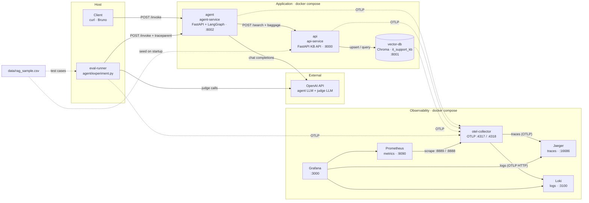
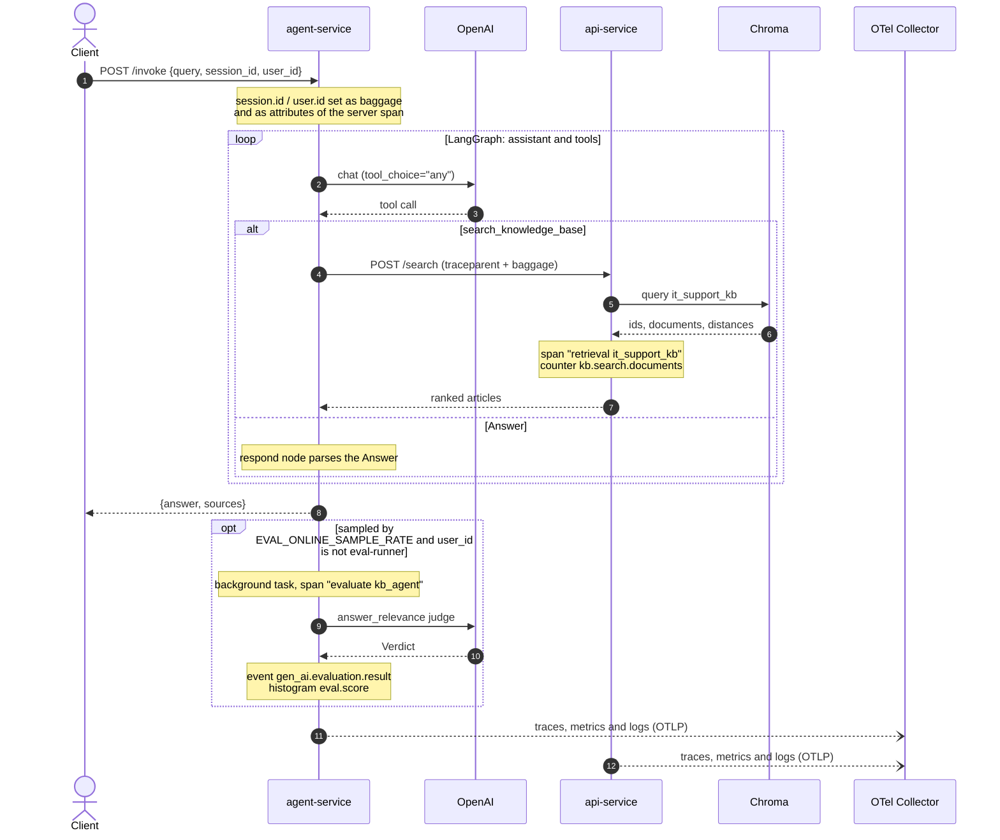
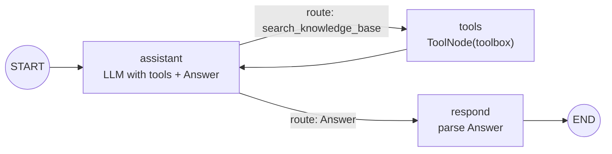
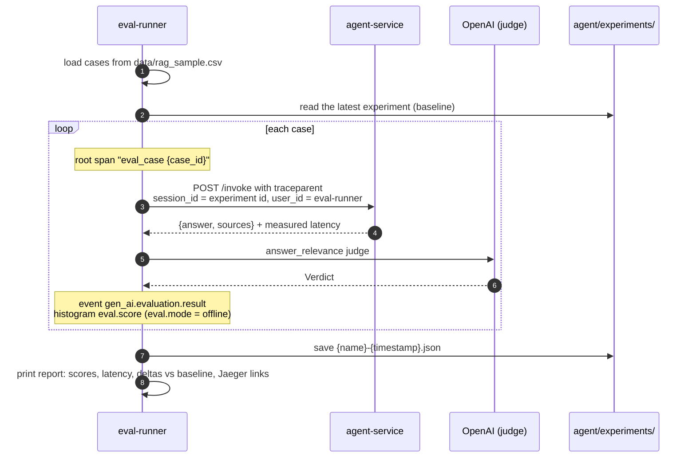

# Agent Obs

**An educational proof of concept for end-to-end observability and evaluation of LLM agents, built on OpenTelemetry.**


An IT Helpdesk RAG agent (LangGraph + OpenAI) answers employee questions from a Chroma knowledge base. Every hop
of a request emits OpenTelemetry **traces, metrics and logs** to a local observability stack (Jaeger, Prometheus,
Loki, Grafana). An **evaluation pipeline** scores the answers **online** (sampled live traffic) and **offline**
(dataset experiments), and writes each score back as telemetry tied to the trace it evaluated.

**What it demonstrates**

- **Zero-code instrumentation** with `opentelemetry-instrument`, plus manual spans, metrics and events where the
  auto-instrumentation stops.
- **GenAI semantic conventions**: agent, LLM and tool spans from LangChain/LangGraph, a hand-made `retrieval` span
  and `gen_ai.evaluation.result` events.
- **Context propagation across services**: W3C `traceparent` and `baggage` (`session.id`, `user.id`) from the client
  through the agent to the knowledge base API.
- **Signal correlation in Grafana**: metrics ↔ traces ↔ logs, pre-provisioned.
- **Online and offline evaluations** with an LLM-as-judge, using the same telemetry contract.

> [!WARNING]
> This is a local-only setup: Grafana grants anonymous admin access, Jaeger keeps traces in memory, and prompts,
> completions and retrieved documents are recorded in the telemetry. Do not use it as-is in production.

## Contents

- [Architecture](#architecture)
- [Workflows](#workflows)
- [Project structure](#project-structure)
- [Getting started](#getting-started)
- [Evaluation pipeline](#evaluation-pipeline)
- [Observability with OpenTelemetry](#observability-with-opentelemetry)
- [Dataset and credits](#dataset-and-credits)

## Architecture

The stack runs on a single Docker network (`agent_obs_network`): two Python services, a vector database and the
observability backends. The offline evaluation runner runs on the host, and the only external dependency is the
OpenAI API.

| Service | Image / build | Host port(s) | `service.name` | Role |
|---|---|---|---|---|
| `agent` | `./agent` | `8002` | `agent-service` | FastAPI wrapper around the LangGraph agent (`POST /invoke`) and the online evaluation |
| `api` | `./app` | `8000` | `api-service` | Knowledge base API: seeds Chroma on startup, `POST /search`, `POST /documents` |
| `vector-db` | `chromadb/chroma` | `8001` | `vector-db-service` | Vector store with the `it_support_kb` collection; exports its own traces |
| `otel-collector` | `otel/opentelemetry-collector-contrib:0.146.0` | `4317`, `4318`, `8888`, `8889`, `13133`, `1888`, `55679` | – | Receives OTLP and fans each signal out to its backend |
| `jaeger` | `jaegertracing/jaeger:2.15.1` | `16686` | – | Trace storage (in memory) and UI |
| `prometheus` | `prom/prometheus:v3.15.0` | `9090` | – | Scrapes the collector, with exemplar storage enabled |
| `loki` | `grafana/loki:3.7.8` | `3100` | – | Log storage with native OTLP ingestion |
| `grafana` | `grafana/grafana:13.2.3` | `3000` | – | Single pane over the three backends, with cross-signal links |
| `eval-runner` (host) | `agent/experiment.py` | – | `eval-runner` | Offline experiment runner, started with `uv` |



Solid arrows are application calls; dotted arrows from the services are telemetry exports.

## Workflows

### Knowledge base seeding

On startup, `app/api.py` reads `data/rag_sample.csv` (mounted read-only at `/data`) and upserts one document per
knowledge item (`ki_text`) into the `it_support_kb` collection. The document id is the slug of `ki_topic`
(e.g. `resetting-a-forgotten-pin`), the same id the offline experiment uses for its cases.

### Agent request (`POST /invoke`)



### Agent graph

The agent (`agent/agent.py`) is a LangGraph state graph. The model is bound to the tools **and** to the `Answer`
schema with `tool_choice="any"`, so every turn either searches the knowledge base or delivers the final answer.



The response is the `Answer` model: `answer` (text) and `sources` (ids of the knowledge base articles used).

### Offline experiment



## Project structure

```text
agent-obs/
├── agent/                           # Agent service + offline evaluation runner
│   ├── agent.py                     # LangGraph graph (assistant → tools → respond) and the Answer model
│   ├── api.py                       # FastAPI POST /invoke, baggage handling, sampled online evaluation
│   ├── evals.py                     # Scorers and evaluate(): emits gen_ai.evaluation.result + eval.score
│   ├── experiment.py                # Offline experiment CLI: runs the dataset, reports, saves JSON
│   ├── llm.py                       # OpenAIModelProvider → ChatOpenAI configured from env vars
│   ├── tools.py                     # search_knowledge_base tool (calls the KB API)
│   ├── Dockerfile                   # uv + opentelemetry-bootstrap + opentelemetry-instrument entrypoint
│   └── pyproject.toml, uv.lock
├── app/                             # Knowledge base API service
│   ├── api.py                       # Chroma seeding, /search (custom retrieval span + counter), /documents
│   ├── schemas.py                   # Pydantic request/response models
│   ├── Dockerfile                   # Same instrumentation pattern as the agent
│   └── pyproject.toml, uv.lock
├── data/
│   └── rag_sample.csv               # 10 IT knowledge items: KB documents + offline test questions
├── docs/api/                        # Bruno (OpenCollection) request collections
│   ├── agent-api/                   # invoke-agent
│   └── knowledge-base-api/          # index-page, search-relevant-documents, add-document
├── observability/
│   ├── otel-collector-config.yaml   # OTLP receivers and the traces / metrics / logs pipelines
│   ├── jaeger-config.yaml           # Jaeger v2: OTLP receiver + in-memory storage
│   ├── prometheus-config.yaml       # Scrape jobs for the collector (app + internal metrics)
│   ├── loki-config.yaml             # Single-node Loki with structured metadata for OTLP
│   └── grafana-datasources.yaml     # Prometheus, Jaeger and Loki datasources + correlations
├── docker-compose.yaml              # The whole stack (8 services)
├── .env.example                     # Ports, model and evaluation settings
└── THIRD_PARTY_NOTICES.md           # Dataset attribution (MIT)
```

`agent/experiments/` is created by the offline runner and is git-ignored.

## Getting started

### Prerequisites

- Docker with Compose v2
- [uv](https://docs.astral.sh/uv/), only needed for the offline experiment runner
- An OpenAI API key

### 1. Configure

```bash
cp .env.example .env
# then set OPENAI_API_KEY in .env
```

`docker-compose.yaml` reads its ports and settings from `.env`, so the file must exist even if you keep the defaults.

| Variable | Default | Description |
|---|---|---|
| `OPENAI_API_KEY` | – | Used by the agent and by the judge |
| `LLM_MODEL` / `LLM_TEMPERATURE` / `LLM_MAX_TOKENS` | `gpt-4o` / `0.0` / `2048` | Agent model settings |
| `EVAL_JUDGE_MODEL` | `gpt-4o` | Judge model; falls back to `LLM_MODEL` when empty |
| `EVAL_ONLINE_SAMPLE_RATE` | `1.0` | Share of `/invoke` requests scored online, from `0` (off) to `1` (all) |
| `OTEL_INSTRUMENTATION_GENAI_CAPTURE_MESSAGE_CONTENT` | `SPAN_AND_EVENT` | Record prompts and completions in GenAI telemetry (`NO_CONTENT` to disable) |
| `*_PORT` | see `.env.example` | Host ports of every service |

### 2. Start the stack

```bash
docker compose up -d --build
docker compose ps
```

`api` and `agent` wait for the Chroma healthcheck; the `api` seeds the knowledge base when it starts.

### 3. Talk to the agent

```bash
curl -s http://localhost:8002/invoke \
  -H 'Content-Type: application/json' \
  -d '{"query": "I forgot my PIN, how do I reset it?", "session_id": "sess-123", "user_id": "user-42"}'
```

```json
{ "answer": "1. ...", "sources": ["resetting-a-forgotten-pin"] }
```

`session_id` and `user_id` are optional; when present they tag every span of the request. The knowledge base API
can also be called directly:

```bash
# semantic search
curl -s http://localhost:8000/search \
  -H 'Content-Type: application/json' \
  -d '{"query": "reset forgotten PIN", "n_results": 2}'

# add a document (the id is optional, a UUID is generated otherwise)
curl -s http://localhost:8000/documents \
  -H 'Content-Type: application/json' \
  -d '{"id": "unlocking-a-locked-user-account", "text": "**Unlocking a Locked User Account** ..."}'
```

The same requests are available as [Bruno](https://www.usebruno.com/) collections in `docs/api/` (environment
`local`), and FastAPI serves interactive docs at `http://localhost:8002/docs` and `http://localhost:8000/docs`.

### 4. Explore the telemetry

| Tool | URL | What to look at |
|---|---|---|
| Grafana | http://localhost:3000 | Explore with the Jaeger, Prometheus and Loki datasources, linked to each other (no login) |
| Jaeger | http://localhost:16686 | Services `agent-service`, `api-service`, `vector-db-service`, `eval-runner` |
| Prometheus | http://localhost:9090 | `agent_obs_*` series |
| Collector zPages | http://localhost:55679/debug/tracez | Live view of the spans going through the collector |
| Collector health | http://localhost:13133 | Health check endpoint |

`docker compose logs -f otel-collector` also prints every signal received, thanks to the `debug` exporter.

### 5. Run an offline experiment

With the stack running:

```bash
cd agent
uv sync
uv run opentelemetry-instrument --service_name eval-runner python experiment.py --name baseline
```

| Option / variable | Default | Description |
|---|---|---|
| `--name` | `experiment` | Experiment name, e.g. the change under test; the id is `{name}-{YYYYmmdd-HHMMSS}` |
| `--dataset` | `data/rag_sample.csv` | CSV with `ki_topic` and `sample_question` columns |
| `AGENT_URL` | `http://localhost:${AGENT_PORT}` | Agent endpoint |
| `JAEGER_UI_URL` | `http://localhost:${JAEGER_UI_PORT}` | Base URL of the trace links in the report |

The runner loads the repository `.env` and exports OTLP to `localhost:4317`, the collector port published by Compose.

### 6. Stop

```bash
docker compose down      # keep the volumes
docker compose down -v   # also drop the Chroma, Prometheus, Loki and Grafana data
```

## Evaluation pipeline

Both modes share one function, `evaluate()` in `agent/evals.py`. It runs the scorer and emits the result as
telemetry **in the current trace context**, so every score is attached to the trace of the answer it judged.

```text
evaluate(query, answer, mode, **attributes)
 ├─ answer_relevance(query, answer)  → Score(name, value ∈ [0, 1], label, explanation)
 ├─ event      gen_ai.evaluation.result  → Loki        (with the trace_id / span_id of the current span)
 └─ histogram  eval.score                → Prometheus  (gen_ai.evaluation.name, eval.mode)
```

| | Online | Offline |
|---|---|---|
| Goal | Monitor the quality of real traffic | Compare agent versions on a fixed dataset |
| Trigger | Sampled `POST /invoke` requests | `agent/experiment.py` CLI |
| Runs in | `agent-service`, as a background task after the response is sent | `eval-runner` process on the host |
| Input | Live query and served answer | `sample_question` of each row of `data/rag_sample.csv` |
| Trace | `evaluate kb_agent` span inside the request trace | `eval_case {case_id}` root span, with the agent spans nested |
| `eval.mode` | `online` | `offline` |
| Output | Event + metric | Event + metric + console report + JSON file |

### Scorers

| Scorer | Type | Inputs | Score | Modes |
|---|---|---|---|---|
| `answer_relevance` | LLM-as-judge | query, answer | `pass` = 1.0 · `partial` = 0.5 · `fail` = 0.0, plus explanation | online, offline |

`answer_relevance` asks the judge whether the answer **addresses the question**, without judging factual
correctness, so it needs no reference answer and can run on live traffic too:

- **pass**: the answer directly addresses the question.
- **partial**: the answer is related but evasive, incomplete or padded with unrelated content.
- **fail**: the answer does not address the question.

The judge is `EVAL_JUDGE_MODEL` (or `LLM_MODEL`) at temperature `0`, with structured output (`Verdict`) that asks
for the reasoning **before** the label.

### Online evaluation

- `EVAL_ONLINE_SAMPLE_RATE` sets the share of requests scored (`0` disables it, the Compose default when unset).
- Scoring runs in a FastAPI `BackgroundTasks` job, so it adds no latency to the response.
- The request context is handed to the task, so `evaluate kb_agent` is a child of the `POST /invoke` span and carries
  `session.id` / `user.id`, even though it runs after the response.
- Requests with `user_id=eval-runner` are skipped, because the offline runner already scores them.

### Offline experiments

- **Cases**: one per row of `data/rag_sample.csv`. The query is `sample_question`; the case id is the slug of
  `ki_topic`, which is also the knowledge base document id, so it can be matched against the `sources` of the answer.
- **Traces**: each case is its own trace. The runner injects `traceparent` into the HTTP call, so the agent and KB
  spans nest under `eval_case {case_id}`, and sends the experiment id as `session_id`, so all spans of an experiment
  can be filtered by `session.id`.
- **Results**: saved to `agent/experiments/{experiment_id}.json` with the summary (mean of each scorer and of the
  latency) and, per case, the query, answer, sources, scores, latency and `trace_id`, or the error.
- **Comparison**: the report shows the deltas against the most recent experiment saved before the run.

Example report (illustrative values):

```text
Experiment prompt-v2-20261020-101530 (10 cases, 0 errors)

case                                                  answer_relevance  latency_s
setting-up-a-mobile-device-for-company-email                      1.00       4.21
resetting-a-forgotten-pin                                         1.00       3.02
configuring-vpn-access-for-remote-workers                         1.00       4.87
...
mean                                                              0.95       3.64
baseline                                                         +0.05      -0.18

(baseline: baseline-20261020-094512)

Traces:
  setting-up-a-mobile-device-for-company-email: http://localhost:16686/trace/4bf92f3577b34da6a3ce929d0e0e4736
  ...
```

### Inspecting the results

```logql
# Loki: every evaluation result, online and offline
{service_name=~"agent-service|eval-runner"} | gen_ai_evaluation_name != ""

# Loki: the results of one experiment
{service_name="eval-runner"} | eval_experiment_id = "prompt-v2-20261020-101530"
```

```promql
# Prometheus: mean score per scorer and mode over the last 15 minutes
sum by (gen_ai_evaluation_name, eval_mode) (rate(agent_obs_eval_score_sum[15m]))
  /
sum by (gen_ai_evaluation_name, eval_mode) (rate(agent_obs_eval_score_count[15m]))

# Prometheus: score distribution of the online evaluation
sum by (le) (agent_obs_eval_score_bucket{eval_mode="online"})
```

In Jaeger, search `agent-service` for the operation `evaluate kb_agent`, or for the tag `session.id=<experiment id>`.

### Adding a scorer

1. Write a function in `agent/evals.py` that returns a `Score` (value between 0 and 1; `label` and `explanation` are
   optional):

   ```python
   def conciseness(query: str, answer: str) -> Score:
       """Deterministic: penalize answers longer than 150 words."""
       return Score(name="conciseness", value=1.0 if len(answer.split()) <= 150 else 0.0)
   ```

2. Make `evaluate()` run a list of scorers and emit the event and the histogram for each `Score` (the emission code
   stays the same, it is already keyed by `score.name`):

   ```python
   SCORERS = [answer_relevance, conciseness]

   def evaluate(query, answer, mode, **attributes) -> list[Score]:
       scores = [scorer(query, answer) for scorer in SCORERS]
       for score in scores:
           ...  # emit gen_ai.evaluation.result + record eval.score
       return scores
   ```

3. Update the callers: `evaluate_online` in `agent/api.py`, `run_case` in `agent/experiment.py`
   (`{score.name: score.model_dump() for score in scores}`) and the report columns in `print_report`.

New scorers appear in Loki and Prometheus with no extra setup, since both signals are labelled by
`gen_ai.evaluation.name`. Scorers that need a reference answer (the dataset has an unused `sample_ground_truth`
column) can only run offline.

## Observability with OpenTelemetry

### Setup

- **Zero-code instrumentation**: both Dockerfiles run `opentelemetry-bootstrap -a requirements | uv add --requirement -`
  at build time, which installs the instrumentations for the libraries it detects (FastAPI, httpx, logging…), and
  start the app with `opentelemetry-instrument --service_name <name> fastapi run`.
- **Additional packages**:

  | Package | Service | Provides |
  |---|---|---|
  | `opentelemetry-instrumentation-genai-langchain` | agent | GenAI spans and metrics for the LangGraph run, chat model calls and tool executions |
  | `opentelemetry-instrumentation-chromadb` | api | Spans for the Chroma client calls |
  | `opentelemetry-processor-baggage` | agent, api | `BaggageSpanProcessor`, which copies baggage entries onto span attributes |

- **Chroma server**: exports its own traces natively (`CHROMA_OPEN_TELEMETRY__*`, granularity
  `OPERATION_AND_SEGMENT`) as `vector-db-service`.
- **Manual instrumentation**: the [custom signals](#custom-signals) below.

| Variable | Value | Set in | Effect |
|---|---|---|---|
| `OTEL_EXPORTER_OTLP_ENDPOINT` | `http://otel-collector:4317` | Dockerfiles | OTLP/gRPC export to the collector |
| `OTEL_PYTHON_LOGGING_AUTO_INSTRUMENTATION_ENABLED` | `true` | Dockerfiles | Python `logging` records exported as OTel logs, with `trace_id` / `span_id` |
| `OTEL_METRIC_EXPORT_INTERVAL` | `10000` | Dockerfiles | Metrics exported every 10 s instead of 60 s |
| `OTEL_INSTRUMENTATION_GENAI_CAPTURE_MESSAGE_CONTENT` | `SPAN_AND_EVENT` | `.env` → agent | Prompts and completions recorded on GenAI spans and events |

### Collector pipelines

All signals go through `otel-collector` (`observability/otel-collector-config.yaml`), which batches them and, besides
the `debug` exporter, sends each one to its backend:

| Pipeline | Exporter | Backend |
|---|---|---|
| traces | `otlp` → `jaeger:4317` | Jaeger v2, in-memory storage (up to 100,000 traces) |
| metrics | `prometheus` on `:8889`, namespace `agent_obs`, OpenMetrics format with exemplars | Prometheus job `otel-collector-exporter` |
| logs | `otlp_http/loki` → `loki:3100/otlp` | Loki, attributes stored as structured metadata |

The collector's own metrics (`:8888`) are scraped as the `otel-collector` job. In Prometheus, metric names get the
`agent_obs_` prefix, dots become underscores and the unit is appended (`_total` for counters), while
`service.name` becomes the `job` label.

### Signal correlation in Grafana

`observability/grafana-datasources.yaml` provisions the three datasources already linked to each other:

| From → To | How |
|---|---|
| Metrics → traces | Exemplars (`trace_id`) on Prometheus series open the trace in Jaeger |
| Traces → logs | From a span, query Loki for `trace_id="<trace id>"` (±5 min) |
| Traces → metrics | From a span, "Documents searched (rate)" and "HTTP server duration (p95)" for the span's service |
| Logs → traces | The `trace_id` of a log line gets a "View trace" link to Jaeger |
| Logs → metrics | From a log line, the documents searched rate for its `service_name` |

### Out-of-the-box signals

Produced by the instrumentation libraries, with no code in this repository:

- **HTTP**: FastAPI server spans and `http.server.duration` in `agent-service` and `api-service`; httpx client spans,
  which carry the `traceparent` and `baggage` headers from the agent to the KB API.
- **GenAI** (LangChain instrumentation): an `invoke_workflow` span for the LangGraph run, `chat {model}` spans and
  `execute_tool search_knowledge_base` spans, plus metrics such as `gen_ai.client.token.usage` and
  `gen_ai.client.operation.duration` (`agent_obs_gen_ai_client_token_usage_*`, …).
- **Chroma**: client spans in `api-service` and server spans in `vector-db-service`.
- **Logs**: every Python `logging` record, correlated with its trace.

### Custom signals

Everything below is emitted explicitly by the code in this repository.

#### Metrics

| Instrument | Type | Unit | Attributes | Service · source | Prometheus series |
|---|---|---|---|---|---|
| `kb.search.documents` | Counter: documents returned by each search | `{document}` | – | `api-service` · `app/api.py` | `agent_obs_kb_search_documents_total` |
| `eval.score` | Histogram, buckets `0, 0.25, 0.5, 0.75, 1` | `1` | `gen_ai.evaluation.name`, `eval.mode` | `agent-service`, `eval-runner` · `agent/evals.py` | `agent_obs_eval_score_bucket` / `_sum` / `_count` |

#### Spans

| Span | Kind | Service · source | Attributes | Notes |
|---|---|---|---|---|
| `retrieval it_support_kb` | `CLIENT` | `api-service` · `app/api.py` | `gen_ai.operation.name=retrieval`, `gen_ai.data_source.id`, `gen_ai.retrieval.top_k`, `gen_ai.retrieval.query.text`, `gen_ai.retrieval.documents`, `server.address`, `server.port`, `error.type` (on failure) | GenAI retrieval span around the Chroma query. Documents are a JSON list of `id`, `distance` and `content`; Chroma returns a distance, not a relevance score, so it is not stored as `score` |
| `evaluate kb_agent` | `INTERNAL` | `agent-service` · `agent/api.py` | `session.id`, `user.id` (from baggage) | Online evaluation, child of the `POST /invoke` span; holds the judge's LLM span and the evaluation event |
| `eval_case {case_id}` | `INTERNAL` | `eval-runner` · `agent/experiment.py` | `eval.experiment.id`, `eval.case.id`; `ERROR` status and exception on failure | Root span of each offline case; the agent and KB spans join it |

#### Context propagation and attributes

| Key | Origin | Propagation | Recorded on |
|---|---|---|---|
| `session.id` | `session_id` of `/invoke` | W3C baggage | Every span started by `agent-service` and `api-service` (`BaggageSpanProcessor`), plus the `POST /invoke` server span, set explicitly because it starts before the baggage exists |
| `user.id` | `user_id` of `/invoke` | W3C baggage | Same as `session.id` |
| `gen_ai.conversation.id` | `session_id` passed as LangGraph run metadata | – | GenAI spans of the agent |

#### Events

`gen_ai.evaluation.result` (GenAI semantic conventions), emitted through the OTel Logs API in `agent/evals.py`. It is
stored in Loki with the `trace_id` and `span_id` of the evaluated trace, and its body is `{name}={value}`
(e.g. `answer_relevance=1.00`).

| Attribute | Example |
|---|---|
| `gen_ai.evaluation.name` | `answer_relevance` |
| `gen_ai.evaluation.score.value` | `1.0` |
| `gen_ai.evaluation.score.label` | `pass` |
| `gen_ai.evaluation.explanation` | The judge's reasoning |
| `eval.mode` | `online` or `offline` |
| `eval.experiment.id`, `eval.case.id` | Offline only |

#### Application logs

| Message | Service · source |
|---|---|
| `knowledge base seeded: collection=… documents=…` | `api-service` · `app/api.py` (startup) |
| `search executed: query=… n_results=…` | `api-service` · `app/api.py` |
| `baggage received: session.id=… user.id=…` | `api-service` · `app/api.py` |
| `agent invoked: query=…` | `agent-service` · `agent/api.py` |
| `agent answered: sources=…` | `agent-service` · `agent/api.py` |
| `agent flow finished: session.id=… user.id=…` | `agent-service` · `agent/agent.py` |
| `online evaluation: answer_relevance=…` | `agent-service` · `agent/api.py` |

The two baggage log lines, written at the end of the agent flow and at the last hop of the KB API, show that the
request identifiers crossed both services.

### Useful queries

```promql
# documents returned by the KB searches, per second
sum(rate(agent_obs_kb_search_documents_total[5m]))

# token usage per token type
sum by (gen_ai_token_type) (rate(agent_obs_gen_ai_client_token_usage_sum[5m]))

# p95 HTTP server latency per service
histogram_quantile(0.95, sum by (le, job) (rate(agent_obs_http_server_duration_milliseconds_bucket[5m])))
```

```logql
# all the logs of one trace
{service_name=~".+"} | trace_id = "<trace id>"

# logs of the agent service
{service_name="agent-service"}
```

## Dataset and credits

The knowledge base and the offline test questions come from the
[Sample RAG Knowledge Item Dataset](https://www.kaggle.com/datasets/dkhundley/sample-rag-knowledge-item-dataset)
by `dkhundley` (MIT). See [THIRD_PARTY_NOTICES.md](THIRD_PARTY_NOTICES.md) for the full attribution and license text.
